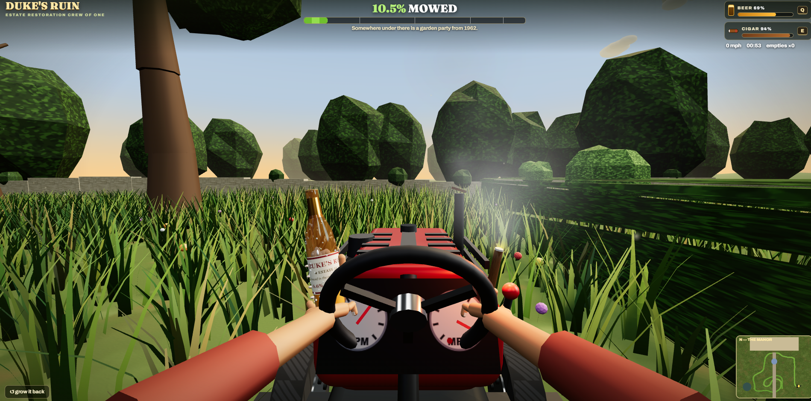
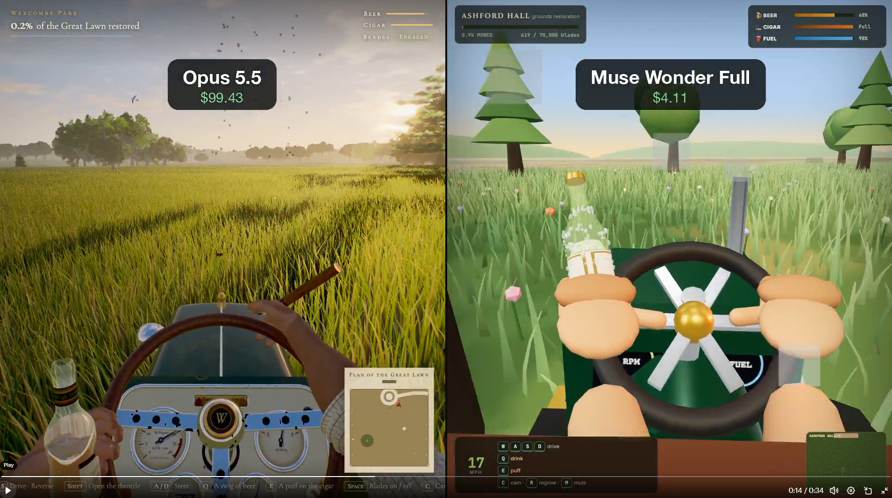

There is a one-shot demo of a lawnmower sim built with three.js.
Graphically, Muse Wonder Full did not perform as well other other frontier providers.

The Meta Team acknowledges this deficit in the current model
> whole team feels dumb now, but it's true, we did not explicitly train our model on 3d demo games. obviously in retrospect we probably should've done a bit of that... but no regrets, please try muse wonder on your actual coding work!

1. We have direct evidence how Muse Wonder Full performs, but we don't have direct evidence with frontier models. Can we confirm the graphical gap.

1. How much would the result change is kept the prompt the same, but rebuilt through Unity MCP or other native engines.

2. If we could do a single follow-up pass to improve graphical visuals, without having to be overally specific what improvements expect?

Here's is the original prompt:
- [lawnmower-sim.m](./lawnmower-sim.md)

Here is a screenshot from our direct evidence of a run against wonder-full-1.0:
- 

Here's is the zip of the generated output from the Wonder Full 1.0 run:
- [lawnmower-sim-wonder-full-1.0.zip](./lawnmower-sim-wonder-full-1.0.zip)

> This package used the [run_benchmark.py](../q001-programatic-user-wonder-full/run_benchmark.py) but future runs will be operated using [meta-benchmark](https://github.com/danphillips-cloud/meta-benchmark)

Here is the author's original claim against Opus 5.5:
- 